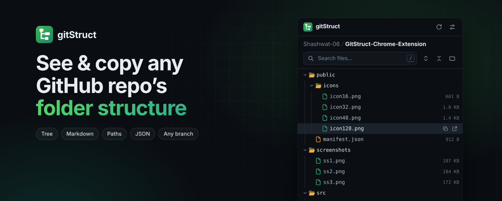
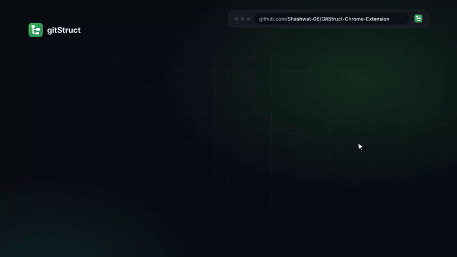
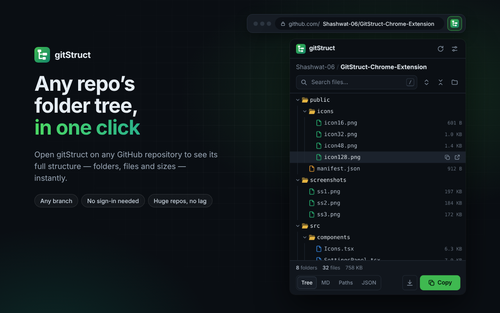
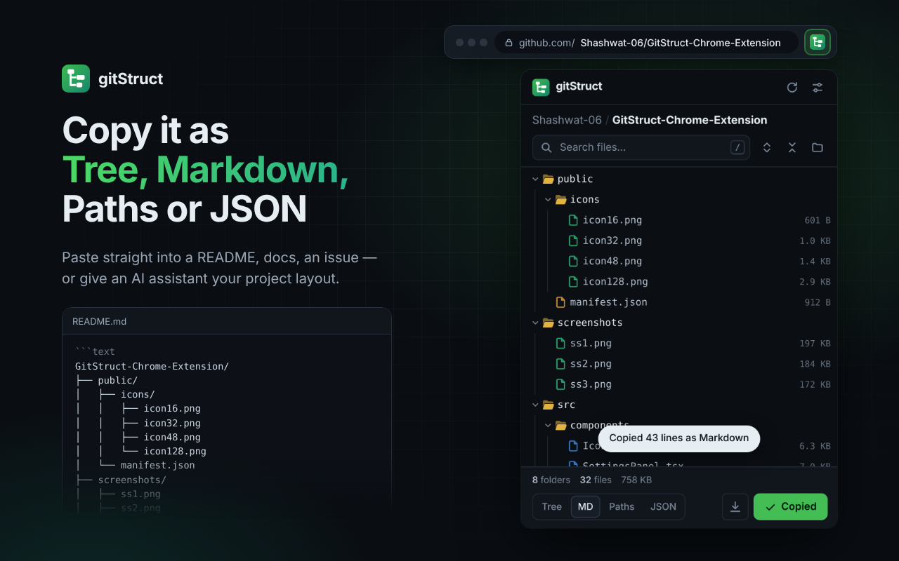
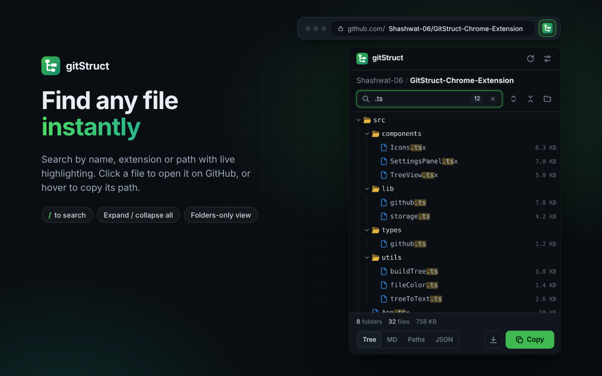
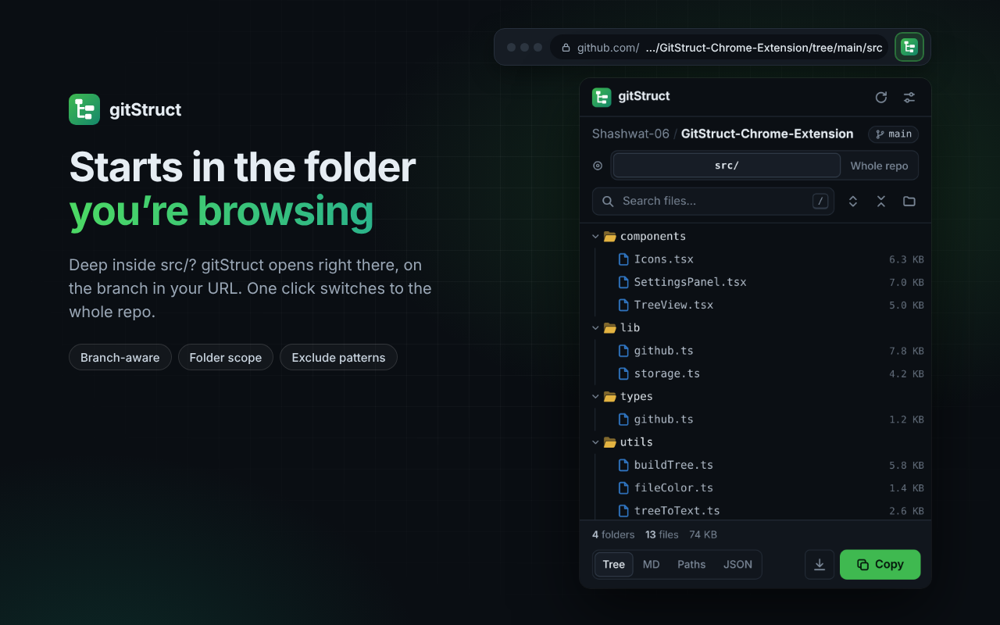
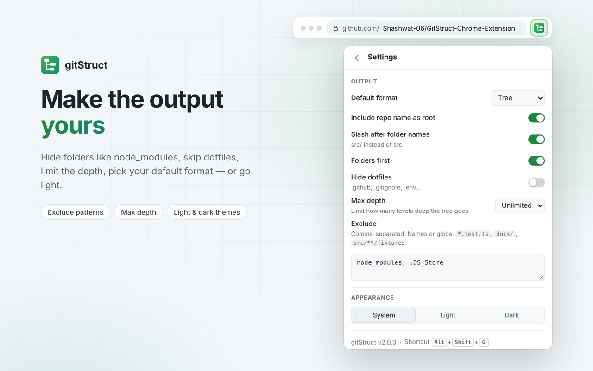
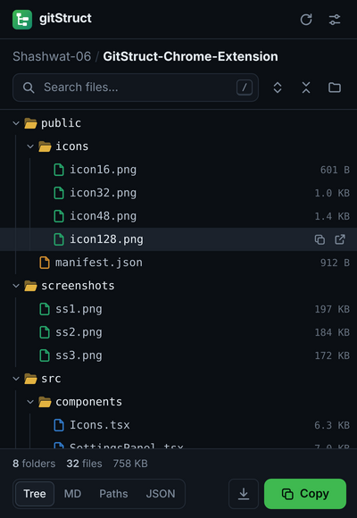
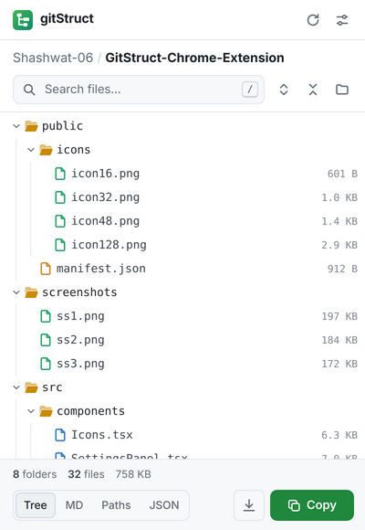

<div align="center">


# gitStruct

**See, search and copy any GitHub repository's folder structure — in one click.**

Copy it as a clean tree, a Markdown block, a path list or JSON. No sign-in, no token, no setup.

[](https://chromewebstore.google.com/detail/pbalofllkaiodaggbhnnaakghapdjnda)




</div>

---

## Contents

- [Demo](#demo)
- [Features](#features)
- [Screenshots](#screenshots)
- [How to use](#how-to-use)
- [Output formats](#output-formats)
- [Settings & filters](#settings--filters)
- [How it works](#how-it-works)
- [Permissions & privacy](#permissions--privacy)
- [Development](#development)
- [Project structure](#project-structure)
- [Contributing](#contributing)
- [License](#license)

---

## Demo

<div align="center">

</div>

---

## Features

| | |
| --- | --- |
| 🌳 **Instant tree** | The whole repository with folder and file-type icons and file sizes |
| 📋 **4 copy formats** | Terminal-style **Tree**, **Markdown** code block, **Paths** list, or **JSON** |
| 💾 **Download** | Save the structure as `.txt`, `.md` or `.json` |
| 🔍 **Search** | Filter by name, extension or path, with matches highlighted |
| 🌿 **Any branch** | Reads the branch from the URL (even `feature/login`) or uses the default branch |
| 📁 **Folder scope** | Opens in the folder you're browsing, and one click shows the whole repo |
| 🧹 **Filters** | Exclude patterns, hide dotfiles, max depth, folders first, folders-only view |
| 🔗 **Jump to GitHub** | Click any file to open it; hover to copy its path |
| ⚡ **Fast on huge repos** | Virtualized list, tested with 24,000+ files |
| 🔓 **No sign-in** | Works on any public repo straight away, with no token or account |
| 🛟 **Never stuck** | Results are cached for 30 minutes, and a backup source takes over if GitHub is busy |
| 🌗 **Light & dark** | Follows your system, or pick one |
| ⌨️ **Keyboard friendly** | `Alt+Shift+G` opens it, `/` searches, `Esc` clears |

---

## Screenshots

<table>
  <tr>
    <td width="50%"></td>
    <td width="50%"></td>
  </tr>
  <tr>
    <td align="center"><b>Any repo's tree in one click</b></td>
    <td align="center"><b>Copy as Tree, Markdown, Paths or JSON</b></td>
  </tr>
  <tr>
    <td width="50%"></td>
    <td width="50%"></td>
  </tr>
  <tr>
    <td align="center"><b>Find any file instantly</b></td>
    <td align="center"><b>Starts in the folder you're browsing</b></td>
  </tr>
</table>

<div align="center">

<br /><b>Make the output yours</b>
</div>

### Light & dark

<div align="center">

&nbsp;&nbsp;&nbsp;

</div>

---

## How to use

1. **Install** gitStruct from the [Chrome Web Store](https://chromewebstore.google.com/detail/pbalofllkaiodaggbhnnaakghapdjnda).
2. **Open any repository** on github.com. It can be the repo's home page, a folder, a file or another branch.
3. **Click the gitStruct icon** in the toolbar, or press **Alt+Shift+G**.
4. **Pick a format** at the bottom (Tree, MD, Paths or JSON) and click **Copy**, or use the ⬇ button to download it.
5. **Paste** it into a README, docs, an issue, a pull request or an AI chat.

> **Tip:** not on GitHub? Type `owner/repo` (for example `facebook/react`) into the popup from any page.

> **Tip:** pin gitStruct with the 🧩 puzzle icon in Chrome's toolbar so it's always one click away.

---

## Output formats

<details open>
<summary><b>Tree</b>: terminal style, like the <code>tree</code> command</summary>

```text
my-app/
├── public/
│   └── favicon.svg
├── src/
│   ├── components/
│   │   └── Button.tsx
│   ├── App.tsx
│   └── main.tsx
├── package.json
└── README.md
```

</details>

<details>
<summary><b>Markdown</b>: the same tree, wrapped in a code block ready for any <code>.md</code> file</summary>

````markdown
```text
my-app/
├── public/
│   └── favicon.svg
├── src/
│   ├── components/
│   │   └── Button.tsx
│   ├── App.tsx
│   └── main.tsx
├── package.json
└── README.md
```
````

</details>

<details>
<summary><b>Paths</b>: one path per line, folders end with <code>/</code></summary>

```text
public/
public/favicon.svg
src/
src/components/
src/components/Button.tsx
src/App.tsx
src/main.tsx
package.json
README.md
```

</details>

<details>
<summary><b>JSON</b>: nested, for scripts and tools</summary>

```json
{
  "name": "my-app",
  "type": "folder",
  "children": [
    { "name": "public", "type": "folder", "children": [{ "name": "favicon.svg", "type": "file" }] },
    {
      "name": "src",
      "type": "folder",
      "children": [
        { "name": "components", "type": "folder", "children": [{ "name": "Button.tsx", "type": "file" }] },
        { "name": "App.tsx", "type": "file" },
        { "name": "main.tsx", "type": "file" }
      ]
    },
    { "name": "package.json", "type": "file" },
    { "name": "README.md", "type": "file" }
  ]
}
```

</details>

**What you see is what you copy.** Filters, scope and depth apply to both the popup and the copied text.

---

## Settings & filters

Open settings with the sliders icon in the top-right of the popup. Your settings are saved, and they sync across your Chrome profiles if you use Chrome Sync.

| Setting | What it does | Default |
| --- | --- | --- |
| **Default format** | Tree, Markdown, Paths or JSON | Tree |
| **Include repo name as root** | Adds `my-app/` as the first line | On |
| **Slash after folder names** | `src/` instead of `src` | On |
| **Folders first** | Folders above files at each level | On |
| **Hide dotfiles** | Hides `.github`, `.gitignore`, `.env`… | Off |
| **Max depth** | Limit how many levels deep the tree goes | Unlimited |
| **Exclude** | Comma-separated names or globs to hide | `node_modules, .DS_Store` |
| **Theme** | System, Light or Dark | System |

**Exclude pattern examples**

| Pattern | Hides |
| --- | --- |
| `node_modules` | Any file or folder named `node_modules` |
| `*.test.ts` | All files ending in `.test.ts` |
| `docs/` | Folders named `docs` (the trailing `/` means folders only) |
| `src/**/fixtures` | `fixtures` anywhere under `src` |
| `*.lock, *.log` | Lock files and logs |

The **folders-only** button in the toolbar and the **"N hidden"** counter in the footer show you what's being left out.

---

## How it works

```text
You click gitStruct
        │
        ▼
Read the tab URL (activeTab) ──► owner / repo / branch / folder
        │
        ▼
Cached in the last 30 min? ──yes──► show it instantly
        │ no
        ▼
GitHub API: 1 request ──► git/trees/<branch>?recursive=1
        │ (if GitHub is rate-limiting or unreachable)
        ▼
Backup: jsDelivr's public file list for the same repo
        │
        ▼
Build the tree, apply filters, show it (and copy it)
```

- **One request per repo.** GitHub allows 60 anonymous API requests an hour per network. gitStruct uses one per repo, and the 30-minute cache means browsing around a repo costs nothing extra.
- **Branches with slashes** like `feature/login` are resolved by matching them against the repo's branches.
- **Big repos.** GitHub returns up to 100,000 entries. If a repo is larger, gitStruct shows what it got and tells you.
- **Public repos only.** There's no sign-in, so private repositories can't be read.

---

## Permissions & privacy

| Permission | Why |
| --- | --- |
| `activeTab` | Read the current tab's URL, **only when you click the extension**, to know which repo to show |
| `storage` | Save your settings and a 30-minute cache of repo trees, in your own browser |

- ❌ No data collection, analytics, tracking or ads
- ❌ No accounts, passwords or tokens
- ✅ Only talks to `api.github.com`, plus `data.jsdelivr.com` as a backup, to fetch public file lists

📄 Full policy: **[Privacy Policy](https://shashwat-06.github.io/YOUR-PRIVACY-REPO/privacy.html)**

---

## Development

**Requirements:** Node.js 20.19+ (or 22.12+) and npm.

```bash
git clone https://github.com/Shashwat-06/GitStruct-Chrome-Extension.git
cd GitStruct-Chrome-Extension
npm install
npm run build
```

**Load it in Chrome**

1. Open `chrome://extensions`.
2. Turn on **Developer mode** (top-right).
3. Click **Load unpacked** and select the **`dist`** folder. Don't pick the project folder itself; it has no manifest at the top level.
4. After changing code, run `npm run build` again and click the ↻ reload icon on the extension card.

**Scripts**

| Command | What it does |
| --- | --- |
| `npm run dev` | Runs the popup in a normal browser tab with hot reload. Add `?url=https://github.com/owner/repo` to load a repo |
| `npm run build` | Type-checks and builds the extension into `dist/` |
| `npm run zip` | Builds and creates `gitstruct.zip`, ready for the Chrome Web Store |
| `npm run lint` | Runs ESLint |

**Tech stack:** TypeScript · React 19 · Vite · Chrome Extensions Manifest V3 · plain CSS (no UI framework)

---

## Project structure

_Generated with gitStruct itself_ 🙂

```text
GitStruct-Chrome-Extension/
├── docs/
│   └── images/                 # README images
├── public/
│   ├── icons/                  # 16, 32, 48, 128 px extension icons
│   └── manifest.json           # Chrome extension manifest (MV3)
├── src/
│   ├── components/
│   │   ├── Icons.tsx           # Inline SVG icons
│   │   ├── SettingsPanel.tsx   # Settings screen
│   │   └── TreeView.tsx        # Virtualized, collapsible tree
│   ├── lib/
│   │   ├── github.ts           # URL parsing, GitHub API, jsDelivr fallback, cache
│   │   └── storage.ts          # chrome.storage wrapper (settings + cache)
│   ├── types/
│   │   └── github.ts           # Shared types
│   ├── utils/
│   │   ├── buildTree.ts        # Flat paths → tree, filters, sorting, search
│   │   ├── fileColor.ts        # File-type colours
│   │   └── treeToText.ts       # Tree / Markdown / Paths / JSON output
│   ├── App.css
│   ├── App.tsx                 # Popup UI and state
│   ├── index.css               # Theme tokens (light/dark)
│   └── main.tsx
├── CHANGELOG.md
├── index.html
├── package.json
├── LICENSE
├── README.md
└── vite.config.ts
```

---

## Contributing

Bug reports, ideas and pull requests are welcome.

1. Fork the repo and create a branch: `git checkout -b feature/my-idea`
2. Make your change, then run `npm run lint` and `npm run build`
3. Load `dist/` unpacked and test it on a few repos
4. Open a pull request describing what changed and why

Found a bug? [Open an issue](https://github.com/Shashwat-06/GitStruct-Chrome-Extension/issues) and include the repo URL you were on.

See [CHANGELOG.md](CHANGELOG.md) for release history.

---

## License

Released under the [MIT License](LICENSE).

<div align="center">

Made by [Shashwat Ojha](https://github.com/Shashwat-06) · [work.shashwatojha@gmail.com](mailto:work.shashwatojha@gmail.com)

If gitStruct saves you time, please ⭐ the repo and [leave a review](https://chromewebstore.google.com/detail/pbalofllkaiodaggbhnnaakghapdjnda) on the Chrome Web Store!

</div>
